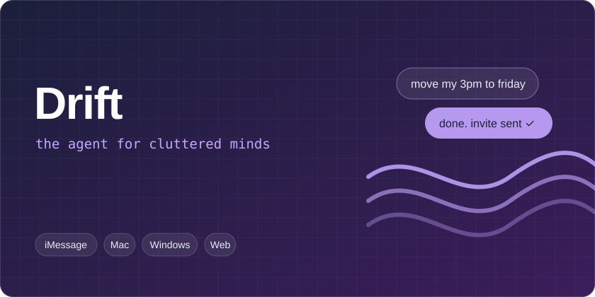
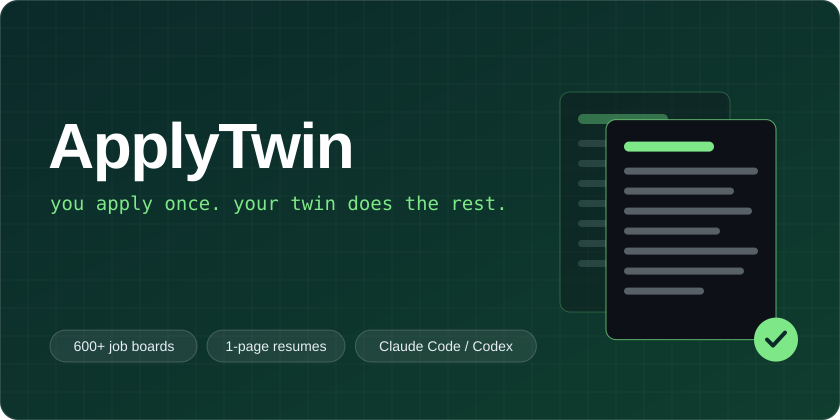

<a href="https://github.com/aadityamittal1">
  <picture>
    <source media="(prefers-color-scheme: dark)" srcset="./assets/terminal-dark.svg">
    
  </picture>
</a>

 

I'm Aadi. I study CS at Georgia Tech and spend most of my time shipping: I'm a founding engineer at **Presence**, I co-founded **Drift** with my brother, and I build tools I actually want to use. I care about agents that do real work, systems that don't fall over, and getting things in front of users fast.

## What I'm building

<table>
  <tr>
    <td width="50%" valign="top">
      
      <h3><a href="https://usedrift.us">Drift</a></h3>
      A personal AI agent you text. It handles email, calendar and tasks under approval rules you set. Runs on iMessage, Mac, Windows and the web.
        
      <b>Co-founder</b> · React, TypeScript, MCP, Capacitor · 10+ integrations · 50+ beta users before launch
    </td>
    <td width="50%" valign="top">
      
      <h3><a href="https://apply.twinly.tech">ApplyTwin</a></h3>
      Open-source job-search autopilot. Reads 600+ company career boards, tailors a one-page resume per posting with a fact check that blocks invented claims, and fills the application through your own Claude Code or Codex.
        
      Python, Supabase, browser agents · free
    </td>
  </tr>
</table>

## Also

- **[gokv](https://github.com/aadityamittal1/gokv)** — a Redis-compatible key-value server written from scratch in Go: RESP2 over TCP, concurrent clients, append-only-file persistence, tested against real Redis. *In progress.*
- **claude-seats-windows** — a Windows port of claude-seats: up to eight Claude Code sessions in one Windows Terminal window, planning, building and fixing each other's bugs as a team.
- **AidSnap** — photo in, first-aid steps out. TensorFlow injury classifier, on-device YOLOv10 supply detection, and a fine-tuned LLM to keep instructions short.
- **HackAlphaX** — Executive Director of a student org running global hackathons and CTFs.

## Toolbox

  

## Activity

<picture>
  <source media="(prefers-color-scheme: dark)" srcset="https://raw.githubusercontent.com/aadityamittal1/aadityamittal1/output/snake-dark.svg">
  
</picture>

---

Open to Summer 2027 SWE / ML internships. Find me at <a href="https://usedrift.us">usedrift.us</a>.
